# Guia de estilo do Plano

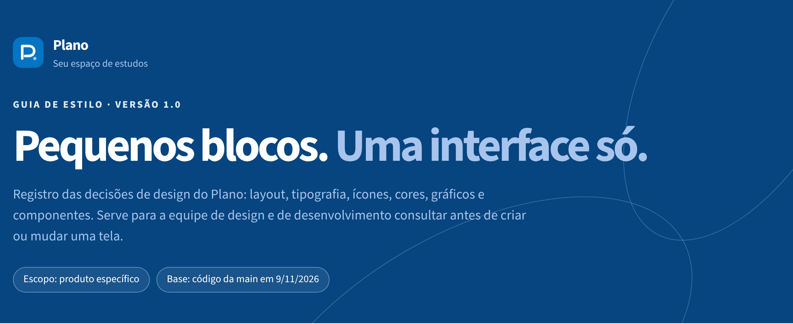

**Versão 1.0** · Escopo: produto específico · Base: código da `main` em 9/11/2026

Registro das decisões de design do Plano: layout, tipografia, ícones, cores, gráficos e componentes. Serve para a equipe de design e de desenvolvimento consultar antes de criar ou mudar uma tela.

## Sumário

- [Sobre o guia](#sobre-o-guia)
- [Princípios](#princípios)
- [Layout](#layout)
- [Tipografia](#tipografia)
- [Simbolismo](#simbolismo)
- [Cores](#cores)
- [Visualização de informação](#visualização-de-informação)
- [Telas e widgets](#telas-e-widgets)
- [Linguagem](#linguagem)
- [Padrões de design](#padrões-de-design)
- [Pendências](#pendências)

---

## Sobre o guia

O Plano ajuda estudantes a transformar o semestre em pequenos blocos de estudo. Este guia reúne as decisões de design já tomadas no app para que elas não se percam a cada nova tela.

O guia tem **escopo de produto específico**: vale para o app web do Plano (Streamlit), nos temas claro e escuro, no desktop e no celular. Ele cobre os seis elementos que um guia de estilo deve registrar: layout, tipografia, simbolismo, cores, visualização de informação e design de telas e widgets.

**Como usar**

- Antes de criar uma tela, confira layout, componentes e linguagem.
- Ao mudar uma cor ou um tamanho, mude o token e atualize este guia no mesmo PR.
- Em dúvida entre duas soluções, escolha a que já existe em outra tela.

**Onde está no código**

| O quê | Arquivo |
|---|---|
| Tokens e estilos | [`src/ui/styles.py`](../../src/ui/styles.py) |
| Tema base do Streamlit | [`.streamlit/config.toml`](../../.streamlit/config.toml) |
| Os 4 lugares e seus ícones | [`src/ui/navigation.py`](../../src/ui/navigation.py) |
| Gráficos | [`src/ui/components/progress_charts.py`](../../src/ui/components/progress_charts.py) |
| Marca | [`assets/plan-logo.svg`](../../assets/plan-logo.svg) |

---

## Princípios

Cada princípio vira uma regra que dá para conferir numa tela.

| Princípio | Como aparece no Plano |
|---|---|
| **Correspondência com as expectativas** | Os lugares seguem o ciclo real de estudo: cadastrar disciplinas, planejar a semana, estudar hoje, ver o progresso. |
| **Simplicidade nas tarefas** | Só 4 lugares na navegação. Nova sessão abre em diálogo por cima da tela, sem trocar de página. |
| **Controle e liberdade** | Concluir sessão oferece Desfazer. Todo diálogo fecha com X ou Esc. O tour pode ser pulado e reaberto pela Ajuda. |
| **Consistência e padronização** | Um verbo por ação e um ícone por significado. Títulos e ícones das páginas vêm de um único arquivo. |
| **Eficiência do usuário** | Nova sessão fica no topo de Hoje e Semana. Valores padrão prontos: hoje, 14h, 60 minutos, prioridade média. |
| **Antecipação** | "Primeiros passos" mostra o próximo passo que falta. Estados vazios dizem o que fazer, não só que está vazio. |
| **Visibilidade e reconhecimento** | O lugar atual fica destacado na sidebar. Cada ação mostra um aviso curto do que aconteceu. |
| **Conteúdo relevante** | Texto curto e direto. Gráficos têm resumo em texto para leitura rápida e leitores de tela. |
| **Projeto para erros** | Excluir pede confirmação e fica longe da ação principal. Erros dizem o que falhou e o que tentar. |

---

## Layout

Toda tela tem a mesma estrutura: navegação fixa à esquerda e uma coluna de conteúdo centralizada que começa sempre pelo cabeçalho da página.

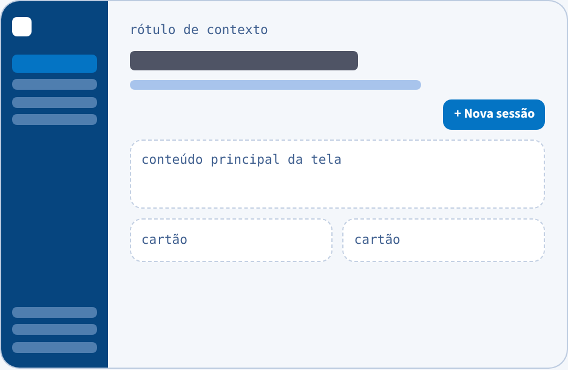

Ordem fixa do topo: rótulo de contexto, título, descrição em uma frase, botão principal à direita, conteúdo.

| Medida | Valor |
|---|---|
| Sidebar | 19rem (18rem no celular) |
| Conteúdo, largura máxima | 1120px, centralizado |
| Respiro do topo | 3,75rem (2,25rem no celular) |
| Respiro do rodapé | 5rem |
| Margem lateral no celular | 1rem |
| Quebra para celular | 640px |
| Descrição da página | até 48rem de largura |

### Metáfora espacial: quatro lugares

O app é uma mesa de estudos com quatro lugares fixos, na ordem do ciclo de uso. A navegação só acontece pela sidebar. Períodos acadêmicos, Ajuda, tema e Sair ficam no rodapé dela, separados por uma linha.

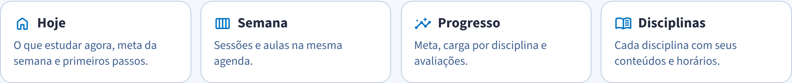

| Lugar | Para quê |
|---|---|
| **Hoje** | O que estudar agora, meta da semana e primeiros passos. |
| **Semana** | Sessões e aulas na mesma agenda. |
| **Progresso** | Meta, carga por disciplina e avaliações. |
| **Disciplinas** | Cada disciplina com seus conteúdos e horários. |

### Superfícies, cantos e sombra

Cantos arredondados crescem com o tamanho do elemento. Todos os blocos de conteúdo usam a mesma sombra suave, `0 12px 32px rgba(6, 69, 127, .08)`.

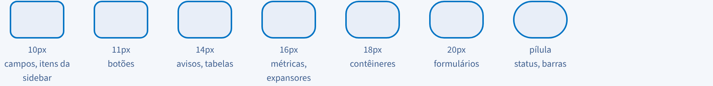

| Raio | Onde |
|---|---|
| 10px | Campos, itens da sidebar |
| 11px | Botões |
| 14px | Avisos, tabelas |
| 16px | Métricas, expansores |
| 18px | Contêineres |
| 20px | Formulários |
| pílula (999px) | Status, barras de progresso |

---

## Tipografia

O app usa a sans-serif padrão do Streamlit, a **Source Sans**, em todos os textos. A hierarquia vem de tamanho e peso, nunca de outra fonte.

Os gráficos usam Inter com fallback para a fonte do sistema, em 11px. Títulos usam espaçamento negativo entre letras (−0,025em) para ficarem compactos. Rótulos em caixa alta usam espaçamento positivo (0,04em a 0,12em) para continuarem legíveis.

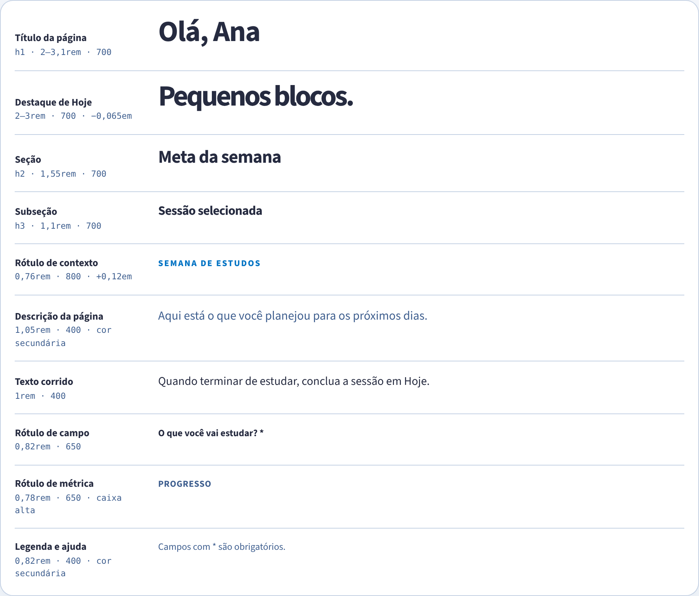

| Papel | Tamanho | Peso | Detalhe |
|---|---|---|---|
| Título da página (h1) | 2–3,1rem | 700 | −0,025em |
| Destaque de Hoje | 2–3rem | 700 | −0,065em |
| Seção (h2) | 1,55rem | 700 | |
| Subseção (h3) | 1,1rem | 700 | |
| Rótulo de contexto | 0,76rem | 800 | +0,12em, azul de ação |
| Descrição da página | 1,05rem | 400 | cor secundária |
| Texto corrido | 1rem | 400 | |
| Rótulo de campo | 0,82rem | 650 | |
| Rótulo de métrica | 0,78rem | 650 | caixa alta, +0,04em |
| Legenda e ajuda | 0,82rem | 400 | cor secundária |

### Uso em diálogos, formulários e relatórios

- **Diálogos:** o título do diálogo é o nome da ação ("Nova sessão", "Editar sessão"). O botão de envio repete o verbo ("Adicionar sessão", "Salvar alterações").
- **Formulários:** rótulo sempre acima do campo, nunca só placeholder. Campo obrigatório leva `*` no rótulo e a legenda "Campos com * são obrigatórios." logo antes do botão.
- **Relatórios (Progresso):** números em peso 750 com espaçamento −0,04em. A unidade sempre aparece junto ("1125 / 600 min", "8,5 de 10").

---

## Simbolismo

Todos os ícones vêm de uma única família, Material Symbols arredondados. Cada ícone tem um único significado, e todo ícone aparece junto de um texto.

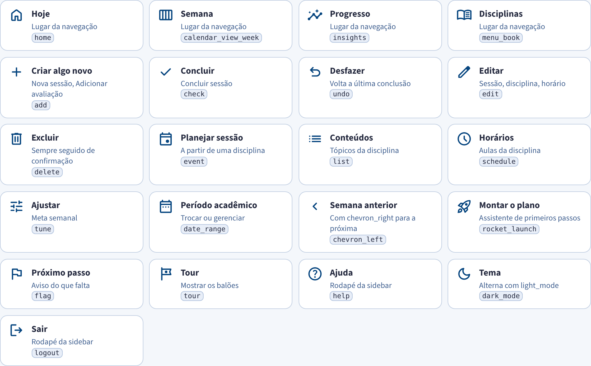

| Ícone | Significado | Onde |
|---|---|---|
| `home` | Hoje | Lugar da navegação |
| `calendar_view_week` | Semana | Lugar da navegação |
| `insights` | Progresso | Lugar da navegação |
| `menu_book` | Disciplinas | Lugar da navegação |
| `add` | Criar algo novo | Nova sessão, Adicionar avaliação |
| `check` | Concluir | Concluir sessão |
| `undo` | Desfazer | Volta a última conclusão |
| `edit` | Editar | Sessão, disciplina, horário |
| `delete` | Excluir | Sempre seguido de confirmação |
| `event` | Planejar sessão | A partir de uma disciplina |
| `list` | Conteúdos | Tópicos da disciplina |
| `schedule` | Horários | Aulas da disciplina |
| `tune` | Ajustar | Meta semanal |
| `date_range` | Período acadêmico | Trocar ou gerenciar |
| `chevron_left` / `chevron_right` | Semana anterior / próxima | Semana |
| `rocket_launch` | Montar o plano | Assistente de primeiros passos |
| `flag` | Próximo passo | Aviso do que falta |
| `tour` | Tour | Mostrar os balões |
| `help` | Ajuda | Rodapé da sidebar |
| `dark_mode` / `light_mode` | Tema | Rodapé da sidebar |
| `logout` | Sair | Rodapé da sidebar |

**Regras**

- Novo ícone só entra se o significado ainda não existir na tabela acima.
- Ícone sozinho não é botão: o texto do botão é obrigatório.
- Ícones dos 4 lugares são definidos uma vez em `navigation.py` e reutilizados em links e atalhos.
- Status de sessão usa símbolo de texto, não ícone: ✓ Concluída, ! Atrasada, ◷ Pendente.

---

## Cores

A paleta é monocromática: azul de ação, azul-marinho e azul-claro sobre fundos frios. Isso deixa as cores das disciplinas como a única variação de matiz na tela.

### Tema claro

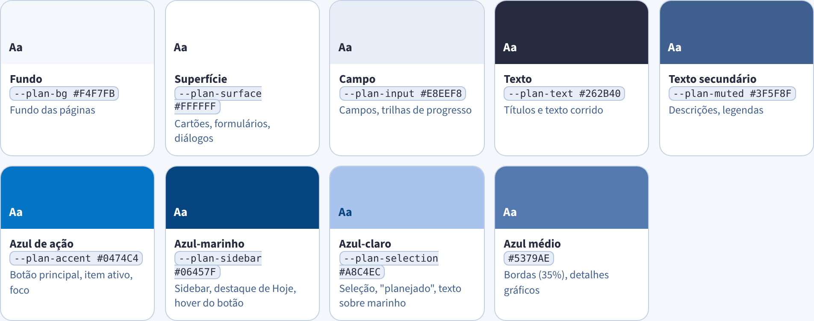

| Nome | Token | Valor | Uso |
|---|---|---|---|
| Fundo | `--plan-bg` | `#F4F7FB` | Fundo das páginas |
| Superfície | `--plan-surface` | `#FFFFFF` | Cartões, formulários, diálogos |
| Campo | `--plan-input` | `#E8EEF8` | Campos, trilhas de progresso |
| Texto | `--plan-text` | `#262B40` | Títulos e texto corrido |
| Texto secundário | `--plan-muted` | `#3F5F8F` | Descrições, legendas |
| Azul de ação | `--plan-accent` | `#0474C4` | Botão principal, item ativo, foco |
| Azul-marinho | `--plan-sidebar` | `#06457F` | Sidebar, destaque de Hoje, hover do botão |
| Azul-claro | `--plan-selection` | `#A8C4EC` | Seleção, "planejado", texto sobre marinho |
| Azul médio | — | `#5379AE` | Bordas (35%), detalhes gráficos |

### Tema escuro

O tema escuro troca só os valores dos tokens. As regras de uso continuam as mesmas.

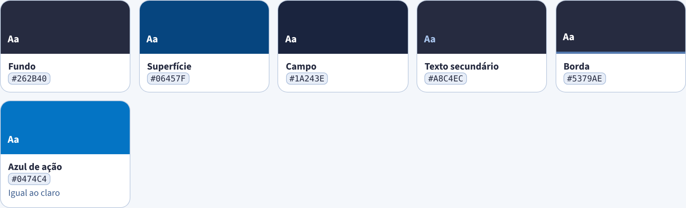

| Nome | Valor |
|---|---|
| Fundo | `#262B40` |
| Superfície | `#06457F` |
| Campo | `#1A243E` |
| Texto secundário | `#A8C4EC` |
| Borda | `#5379AE` |
| Azul de ação | `#0474C4` (igual ao claro) |

### Cores das disciplinas

Cada disciplina tem uma cor escolhida pelo usuário. Ela aparece só como um ponto ao lado do nome e nas séries dos gráficos. Estas são as cores dos dados de exemplo e a sequência dos gráficos:

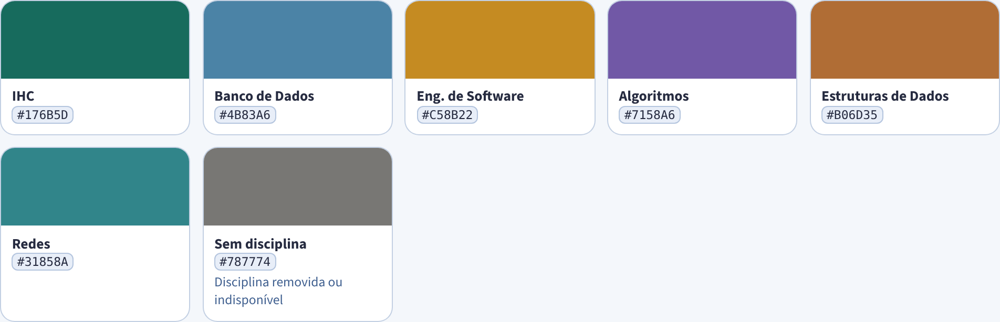

| Disciplina | Cor |
|---|---|
| IHC | `#176B5D` |
| Banco de Dados | `#4B83A6` |
| Engenharia de Software | `#C58B22` |
| Algoritmos | `#7158A6` |
| Estruturas de Dados | `#B06D35` |
| Redes | `#31858A` |
| Sem disciplina (removida ou indisponível) | `#787774` |

### Contraste

Mínimo de 4,5:1 para texto comum e 3:1 para texto grande e ícones (WCAG AA). Valores calculados com as cores do código:

| Par (texto sobre fundo) | Onde aparece | Razão | AA |
|---|---|---|---|
| `#262B40` sobre `#F4F7FB` | Texto sobre fundo | 13,0:1 | ✓ passa |
| `#3F5F8F` sobre `#FFFFFF` | Texto secundário sobre cartão | 6,5:1 | ✓ passa |
| `#3F5F8F` sobre `#E8EEF8` | Texto secundário sobre campo | 5,6:1 | ✓ passa |
| `#FFFFFF` sobre `#0474C4` | Botão principal | 4,9:1 | ✓ passa |
| `#0474C4` sobre `#F4F7FB` | Rótulo de contexto sobre fundo | 4,5:1 | ! no limite |
| `#FFFFFF` sobre `#06457F` | Itens da sidebar | 9,7:1 | ✓ passa |
| `#A8C4EC` sobre `#06457F` | Legendas da sidebar e do destaque | 5,4:1 | ✓ passa |
| `#5379AE` sobre `#FFFFFF` | Texto dos eixos nos gráficos | 4,45:1 | ✗ abaixo |
| `#A8C4EC` sobre `#262B40` | Texto secundário, tema escuro | 7,8:1 | ✓ passa |

### Os dez mandamentos das cores no Plano

1. Use no máximo cinco cores de interface: fundo, texto, azul de ação, azul-marinho e azul-claro. Disciplinas ficam à parte.
2. O azul de ação marca o que pede atenção: botão principal, lugar atual e a parte concluída de uma barra.
3. Nunca use só a cor para dizer algo. Status leva símbolo e texto; gráficos têm legenda e resumo escrito.
4. Texto precisa de 4,5:1 contra o fundo. Texto grande e ícones, de 3:1.
5. A cor da disciplina identifica, não avalia. Ela aparece como ponto ou série de gráfico, nunca como fundo de texto.
6. Mantenha o mesmo código em todas as telas: azul-claro é sempre "planejado" e azul é sempre "concluído".
7. Vermelho fica reservado para mensagens de erro. Não use vermelho e verde como par de significado.
8. Azul-marinho só nas áreas de orientação: sidebar, destaque de Hoje e balões do tour.
9. Componente usa token (`var(--plan-…)`), nunca hex solto, para o tema escuro funcionar sozinho.
10. O amarelo `#F5B301` existe só no tour, para contornar o elemento que está sendo explicado.

---

## Visualização de informação

Os gráficos ficam em Progresso e comparam planejado com concluído. As regras valem para qualquer gráfico novo.

- **Planejado** sempre em azul-claro, **concluído** sempre em azul de ação. No tema escuro, azul médio e azul-claro.
- Barras horizontais quando o eixo tem nomes de disciplina; linha suave quando o eixo é o tempo.
- Fundo transparente, grade só no eixo dos valores, sem linha de zero.
- Todo gráfico vem com uma frase de resumo logo abaixo, gerada a partir dos mesmos dados.
- Barras de progresso: trilha de 0,6rem na cor de campo, preenchimento em azul de ação, cantos em pílula.

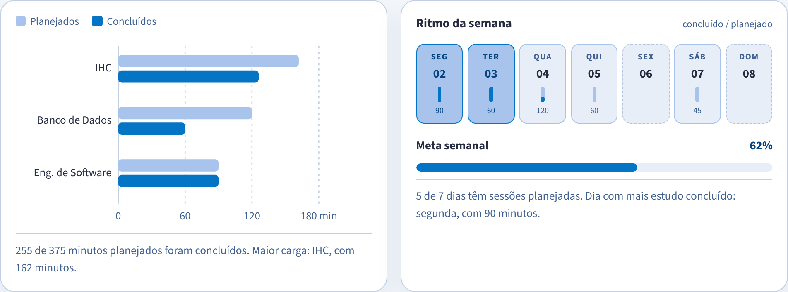

Dias do ritmo: concluído tem fundo azul-claro com borda azul; planejado tem só a borda azul-claro; dia sem sessão tem borda tracejada.

---

## Telas e widgets

Os componentes são os do Streamlit, com o visual ajustado em `styles.py`. Abaixo estão as variações permitidas e quando usar cada uma.

### Botões

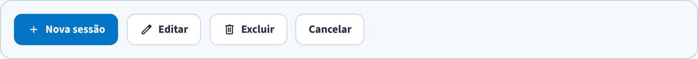

- **Principal** (azul cheio): no máximo um por tela ou por diálogo. É a ação que faz a tarefa andar: Nova sessão, Concluir sessão, Adicionar, Salvar.
- **Secundário** (superfície com borda): todas as outras ações. No hover ganha fundo azul-claro e sobe 1px.
- Altura mínima de 2,7rem (cerca de 43px), boa para toque. Texto em peso 700.
- Excluir nunca fica ao lado do botão principal e nunca é principal antes da confirmação.
- Nova sessão fica logo abaixo do cabeçalho, alinhado à direita, em Hoje e Semana.

### Navegação lateral

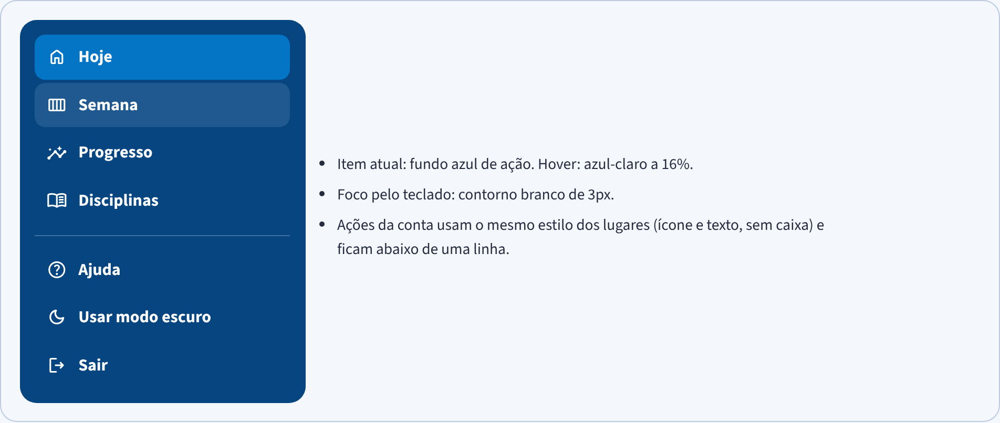

- Item atual: fundo azul de ação. Hover: azul-claro a 16%.
- Foco pelo teclado: contorno branco de 3px.
- Ações da conta usam o mesmo estilo dos lugares (ícone e texto, sem caixa) e ficam abaixo de uma linha.

### Cartão de sessão e status

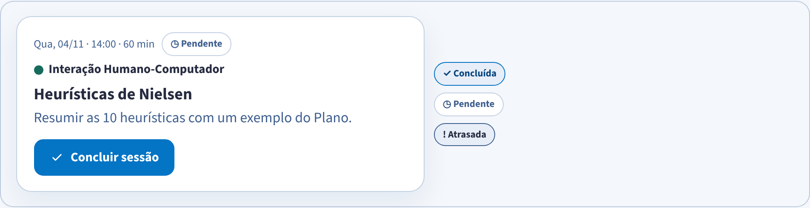

Ordem fixa no cartão: quando, disciplina (com ponto de cor), conteúdo em destaque, objetivo e a ação. O status nunca depende só da cor.

### Campos e diálogos

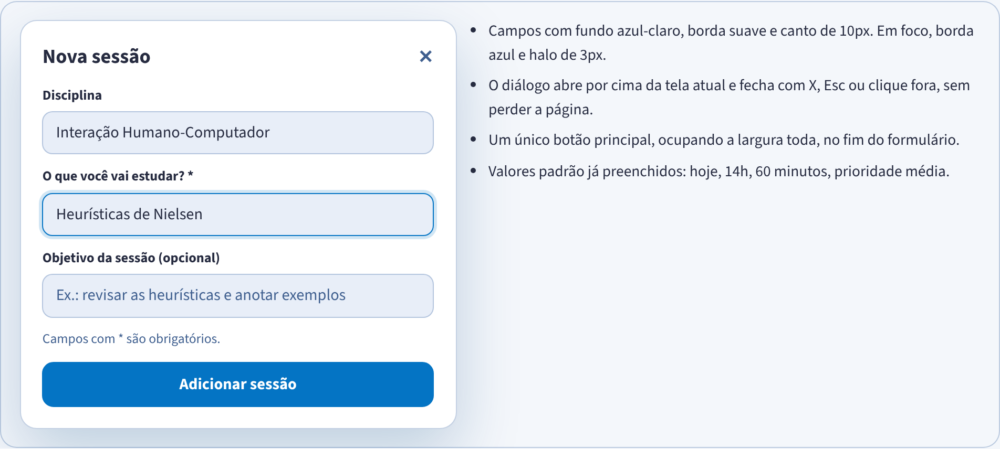

- Campos com fundo azul-claro, borda suave e canto de 10px. Em foco, borda azul e halo de 3px.
- O diálogo abre por cima da tela atual e fecha com X, Esc ou clique fora, sem perder a página.
- Um único botão principal, ocupando a largura toda, no fim do formulário.
- Valores padrão já preenchidos: hoje, 14h, 60 minutos, prioridade média.

### Feedback

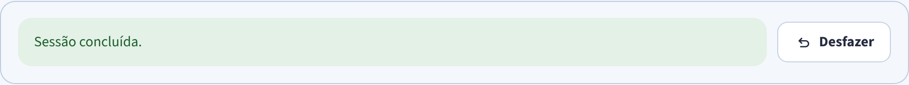

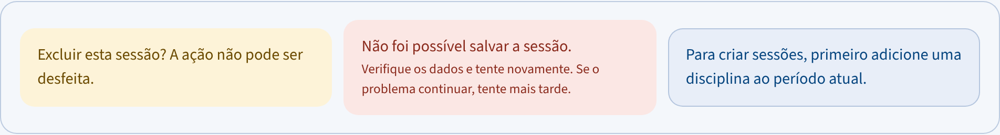

- **Sucesso:** verde, curto, no topo da página depois da ação. Some na próxima interação. Ação frequente ganha feedback sutil.
- **Aviso:** amarelo, só para confirmar algo que não tem volta.
- **Erro:** vermelho, diz o que falhou, sem detalhes técnicos, e o que tentar.
- **Informação:** azul, usado em estados vazios para indicar o próximo passo.

### Tour de boas-vindas

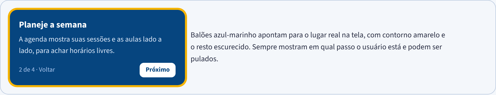

Balões azul-marinho apontam para o lugar real na tela, com contorno amarelo e o resto escurecido. Sempre mostram em qual passo o usuário está e podem ser pulados.

---

## Linguagem

Um verbo para cada ação, sempre o mesmo em botões, mensagens e ajuda.

| Ação | Botão | Mensagem depois |
|---|---|---|
| Criar algo | Adicionar …, ou Nova sessão | "Avaliação adicionada." |
| Mudar algo que existe | Salvar alterações | "Sessão atualizada." |
| Marcar como estudado | Concluir sessão | "Sessão concluída." + Desfazer |
| Voltar a conclusão | Desfazer | "Conclusão desfeita. A sessão voltou para pendente." |
| Apagar | Excluir → Confirmar exclusão | "Sessão excluída." |
| Guardar período antigo | Arquivar → Confirmar arquivamento | "O histórico será preservado." |
| Desistir | Cancelar | nenhuma |

**Faça**

- Botão começa com verbo no infinitivo.
- Mensagem de sucesso é uma frase curta no particípio.
- Estado vazio diz o que fazer: "Ainda não há conteúdos. Adicione o primeiro abaixo."
- Trate o usuário por "você".

**Evite**

- "Criar", "Cadastrar" e "Adicionar" para a mesma ação.
- Botões genéricos como "OK" ou "Enviar".
- Mensagens com termos técnicos ou nomes do banco de dados.
- Pedir desculpas no lugar de explicar o que fazer.

---

## Padrões de design

Cada padrão traz problema, solução, quando usar, como e por quê.

### Concluir com desfazer

- **Problema:** o usuário conclui uma sessão por engano e não tem como voltar.
- **Solução:** concluir na hora, sem pergunta, e mostrar o aviso de sucesso com um botão Desfazer ao lado.
- **Usar quando:** a ação é frequente e pode ser revertida. Para ações sem volta, use a Exclusão em duas etapas.
- **Como:**
  - Aviso verde "Sessão concluída." com o botão secundário Desfazer (ícone `undo`) na mesma linha, à direita.
  - O aviso some na próxima interação.
  - Ao desfazer, confirmar: "Conclusão desfeita. A sessão voltou para pendente."
- **Por quê:** permitir desfazer facilita o aprendizado por exploração e mantém o usuário no controle. Ação frequente pede feedback sutil, não uma janela de confirmação.

### Exclusão em duas etapas

- **Problema:** excluir uma sessão, um horário ou uma disciplina não pode ser desfeito.
- **Solução:** o primeiro clique em Excluir só mostra um aviso e dois botões. A exclusão acontece no segundo clique.
- **Usar quando:** a ação apaga dados de vez. Arquivar período segue a mesma forma.
- **Como:**
  - Aviso amarelo: "Excluir esta sessão? A ação não pode ser desfeita."
  - Botões "Confirmar exclusão" (principal) e "Cancelar" lado a lado.
  - O botão Excluir fica separado da ação principal da tela.
- **Por quê:** deve ser fácil reverter e difícil fazer algo irreversível. Controles perigosos não ficam colados nos usados com frequência.

### Nova sessão em diálogo

- **Problema:** planejar uma sessão é a tarefa mais comum, e ir para outra página faz o usuário perder o contexto.
- **Solução:** um botão principal "Nova sessão" que abre um diálogo por cima da tela atual.
- **Usar quando:** a tarefa é curta (até 6 campos) e o usuário precisa voltar ao mesmo lugar depois.
- **Como:**
  - Botão no topo de Hoje e Semana. Em Disciplinas, "Planejar sessão" abre o mesmo diálogo com a disciplina já escolhida.
  - Editar sessão reaproveita o mesmo diálogo, com título "Editar sessão" e botão "Salvar alterações".
- **Por quê:** simplifica a tarefa e dá atalhos para a ação mais frequente, sem esconder onde o usuário está.

---

## Pendências

O que o código ainda não segue. Cada item é uma correção pequena.

| Item | Onde | Correção sugerida |
|---|---|---|
| Texto dos eixos dos gráficos em `#5379AE` tem 4,45:1, abaixo do mínimo. | `progress_charts.py` | Usar `#3F5F8F`, o mesmo texto secundário das telas. |
| Rótulo de contexto com tamanho forçado em 1,5rem no HTML, enquanto o CSS diz 0,76rem. O comentário no código diz 1rem. | `page_header.py` | Tirar o `style` inline e decidir um tamanho só no CSS. |
| Cor padrão de nova disciplina `#5E6AD2` não está em nenhuma lista. | `forms.py` | Sugerir a próxima cor livre da sequência dos gráficos. |
| `--plan-attention` é igual a `--plan-accent` no tema claro. | `styles.py` | Remover o token ou dar a ele um uso próprio. |
| Muitas cores aparecem como hex direto nas regras, não pelos tokens. | `styles.py` | Trocar por `var(--plan-…)` aos poucos, começando pelos botões. |
